# Full besogo ko labels from the solver: the design to implement

This document is self-contained. It says what the checker must output for a tsumego leaf, how each part of the
label is computed, what changes in `engine.cpp`, `tsumego.py` and the scripts, what it costs, what it prints on the
settled examples, and which questions only the owner can answer. Appendix A records how the three proposals were
judged. Appendix B lists the engine runs behind the claims marked "verified".

Repository: `/home/user/tsumego-hero/tools/tsumego-checker` (the checker), `webroot/besogo/js/status.js` (the labels).
Examples: `research/results/results.json` (the settled leaves), `/tmp/claude-0/dump2/status_problems.jsonl` (SGFs).


> Copies in this repository: the prototype engines as diffs against `engine.cpp` and the prototype scripts are in
> `research/ko_labels/prototypes/`, the judge's scripts and logs in `research/ko_labels/judge/`. The paths below under
> `/tmp/claude-0/proto/research/kodesign/` are where they were run.

---

## 0. Decision in brief

**Base: Design 3 (tempo profiles).** The label's parts come from small searches that answer one question each:

- How many free moves does a side need while it holds the ko? This is a search with the other side forced to pass.
- Who took first?
- What is the direct ko worth once the approaches are played?
- Which local moves are threats? Each one is barred and the threshold re-run.

These searches stay decided in positions where the full threat count does not. On the c121 model board, mode D and
the leaf's threat count are undecided at 2M to 4M nodes. Every search behind the label A-1KO- took between 2 and
403k nodes (at most 1.2 s). The owner's approach rule is not a heuristic added afterwards: it is how the approach
search is defined. In an approach round the opponent's move is a forced tenuki, and what the opponent can gain by
using that move locally is measured and shown separately.

**Grafted from Design 1 (threshold line):**
- the bent-four fix (c027 was printed BENT4);
- the event names used to label each move of an explanation line (retake after a threat, free retake, approach,
  local threat and answer, extra move or stage, second ko);
- the canonical move order for building lines (opponent: retake, then pass, then the search's move);
- the consistency check between the label and the count;
- escalation with a one-ply expansion (`solvemoves`) when a search is undecided;
- warnings when an event touches the area's wall;
- comparison by class first, then approaches, then threats.

**Grafted from Design 2 (static structure):**
- the end playout's ko-capture clause, needed for double ko at high counts (see 0.1);
- PVs from counted searches;
- the `cycles=` counter that triggers the superko re-solve;
- `sekikill` for the SEKI tests;
- the per-part output record;
- the comparison kinds (`ko-approach` splits, `ko-notation`);
- the batch over the owner's own approach and 10kKO leaves as the validation set;
- the plain-language name for the opponent's approach-round gain (Design 2's δ).

### 0.1 Fixes found while judging (all three designs)

1. **Double ko must never be read off counted tables.** On c027 the counted search with Design 3's end rule gives
   a false White win at s=0, o=6. Black wins at o=3 and o=4, the engine's old rule fails from o=4, and Design 2's
   end rule wins at 4, 6 and 8. With the default cycle rule, MODE_N scores a cycle of legal captures as seki,
   which is the wrong verdict for a dead double ko. So DDKO and ADKO come only from the modes with cycle rules
   (definition D10), which decide c027 in 154 to 736 nodes. Designs 1 and 2 used counted tables for this.
2. **End playout trigger.** A double pass in a counted search does not end the game while either holds:
   - (a) a defender chain in the target's area is in atari (Design 3);
   - (b) the side to move has a single-stone ko capture (Design 2).
   With (a) alone c027 fails at o=6. Both clauses apply in MODE_N only, so the class results do not change.
3. **The class can be undecided while the label is not.** On the c121 model, mode A = N but mode D = U at 4M
   nodes. The profile shows the ko anyway: each side wins while it holds the ko. The label is computed and the
   class is printed "KO (inferred)".
4. **The opponent's approach-round gain is measured round by round with small searches**, so it does not need
   the leaf's full count. On c121, "A17! H19 E17 A18" gives d=2 against d=1 with a pass instead of H19. The gain
   can also be negative: on 10005 the full count is one threat better for Black than the label. This is reported
   and not hidden.
5. **Preparation moves before the first take are not approaches.** Design 2's static test counted Black's A16 in
   10005 as an approach (n=2 against the owner's 1). Taking the first take from the line gives n=1 and the owner's
   A-1KO-.
6. **Ties at the leaf.** When the side to move has several moves with the same count, the label is the best one
   for that side by `status.better`. This matches how besogo propagates statuses up the tree. Taking first and
   then approaching can give the same count as approaching first and letting the opponent take.

---

## 1. What the label must contain (besogo's semantics)

`status.js` defines the status of a leaf, always from the problem's first player (the solver), even when that
player is White:

| type (ordinal) | text | fields |
|---|---|---|
| DEAD (2), BENT4 (3), DSKO (4), DDKO (5) | `DEAD`, `BENT4`, `DSKO`, `DDKO` | none |
| 10kKO (6) | `10kKO` | none; ranked like an approach ko in which the attacker needs one approach |
| KO (7) | `[A±n]KO±[m]` | `approaches` (signed), `extraThreats` (signed) |
| SEKI (8) | `SEKI` / `SEKI+` | `sente` |
| ADKO (9), ASKO (10), ALIVE (11) | `ADKO`, `ASKO`, `ALIVE` | none |

- `approaches` = a. a > 0: the opponent needs a approach moves. a < 0: the solver needs |a|.
  Text: `A+a` or `A-|a|`, nothing for 0.
- `extraThreats` = e.
  - e = 0 is `KO+` (the solver takes first) and e = -1 is `KO-` (the opponent takes first).
  - e > 0 is `KO+(e+1)`: the opponent needs e threats to start.
  - e < -1 is `KO-|e|`: the solver needs |e|-1 threats to start.
- Ranking (`status.better`):
  - Different types are compared by ordinal: lower is better for KILL, higher for LIVE.
  - Two KOs are compared by `approaches` first (larger is better for the solver), then by `extraThreats`.
  - 10kKO equals any KO with `approaches` = -1 (KILL) or +1 (LIVE), whatever its threats.
  - SEKI+ is better than SEKI.
- **The count a label implies:** T_label(a, e) = -(a + e). This is the least balance s - o (the solver's outside
  threats minus the opponent's) at which the solver wins, assuming each approach costs one tempo. Examples:

  | label | T | label | T |
  |---|---|---|---|
  | KO+ | 0 | A+1KO+ | -1 |
  | KO+n | 1-n | A-1KO+ | 1 |
  | KO- | 1 | A-1KO- | 2 |
  | KO-n | n | A-2KO- | 3 |

  Labels with equal T can rank differently. For example KO- and A-1KO+ both have T=1, and for KILL besogo ranks
  KO- higher. So the counted threshold alone cannot give the label. That is why the approach count needs its own
  search.

**Where each part of the label comes from:**

| part | definitions |
|---|---|
| `approaches` | D3, D4 and D9 |
| `extraThreats` (who took first plus local threats and stages) | D2, D5, D6 and D7 |
| what the label leaves out (the opponent's free moves in approach rounds) | D8 |
| 10kKO | D9 |
| DDKO, ADKO, DSKO, ASKO | D10 |
| BENT4, SEKI, SEKI+ | D11 |

---

## 2. Notation and engine primitives

- **S** is the solver (the problem's first player) and **O** the opponent. The attacker and defender come from
  the goal. X is a side under test and Y the other side.
- **Counted game G(P; s, o):** the engine's MODE_N search from P (board, side to move, ko ban) with s threats for
  S and o for O.
  - A retake against the ban costs the retaker one threat. Local threats are real moves.
  - The end playout (D13) is on.
- **Threshold d(P):** the least d in [-L, L] (L = 6, extendable) with S winning G(P; d⁺, d⁻), where d⁺ = max(d,0)
  and d⁻ = max(-d,0).
  - d = -inf if S wins at -L; +inf if S fails at +L.
  - It is found by galloping from 0 and bisecting, with results cached by (board, ban, side to move, s, o,
    options).
  - **Shifted check:** S must still win at (d⁺+1, d⁻+1) and fail at ((d-1)⁺+1, (d-1)⁻+1). If not, the result
    depends on the threat counts themselves, not only on s - o, and is flagged. c081 under the old end rule was
    such a case.
- **Forced passes** (`pb=k` / `pw=k`): that colour must pass on its next k turns.
  - A forced pass is a tenuki. It lifts the ko ban, breaks a run of passes and is part of the hash. So it never ends
    the game, and neither do two voluntary passes around it: with the pass count kept, White pass, Black forced pass,
    White pass ended the game although Black never passed, and a defender holder could connect and pass twice.
  - Each forced pass gives the other side one free move.
  - The static "no two eyes" end test, which gives a three-point eye space two eyes only when the attacker does not
    move next, takes the next real move after the forced passes owed. It also gives two eyes when the attacker is
    barred from a point of the space (`fb`/`fw`, or `kb`/`kw` while it moves under the ban), since the defender can
    then play the vital point whenever it likes.
- **A pass already made** (`ps=1`): the position after a voluntary pass, where another pass can end the game.
  `counted_line` uses it after each voluntary pass, so a line through a pass stays in the same game.
- **Barred points:** `fb`/`fw` bar a colour from points for the whole search. `kb`/`kw` bar them only while that
  colour is under a ko ban, so the points cannot serve as ko threats but stay playable otherwise.
- **Cycle rules** for repetitions:
  - 0: today's rule. A cycle with a ban break kills; any other cycle is seki.
  - 1: every cycle kills.
  - 2: every cycle lives. In modes A and D the end under it does not take a ko stone that the defender answers by
    taking another ko (D10).
  - 3: the side that completes the repetition loses (positional superko).
  - Under `sekikill` (`sk=1`) every cycle kills, whatever the rule: only unconditional life lives, and a life that rests
    on a repetition is not. Rule 0 alone scored a cycle of legal captures (sending two, returning one) as seki, which
    is life, so the SEKI tests called a group alive that only lived by repetition (the q6 review: 840 leaf 2 and the
    "no seki" of 15512 and 15518; in 1862 after White's pass and Black's E19, White's F19 forces such a cycle).
- **Outright win of X:** X wins with 0 threats against Lo threats for Y. Lo = max(4, |d|+2), at most 15.

---

## 3. Definitions

### D1 Ko capture and the main ko

- A **ko capture** is a move that captures exactly one stone with a single stone that is then left with one
  liberty (the engine sets `s.ko`).
- **Holder and taker:** for a single stone in atari whose capture would be a ko capture, the stone's owner is the
  holder and the other side is the taker.
- **The main ko κ is chosen in this order:**
  1. the ko of the leaf's ban;
  2. else the ko of the first ko capture on the principal line (D2);
  3. ties go to the shape touching the target or a chain in atari.
- Other ko shapes are noted. Problem 9 c001 has two shapes: the banned B16/B17 ko is κ, and A17/A18 serves as a
  local threat.

### D2 First take, preparation, and the positions P_S and P_O

- **First take F:**
  - If the leaf's last move was a ko capture, F is its mover (c121: White's A18).
  - Otherwise F is the side making the first ko capture on the **principal line**, which is the S-wins line at d
    and the O-wins line at d-1.
  - Each line is built by `counted_line`. The winner's moves come from the search's PV. The loser's resistance is
    the canonical order: retake if it can afford one, else pass while that still costs the solver all its threats,
    else the search's own move.
  - Moves before the first take are **preparation**, for example c023's throw-in A19, c081's White A19, and
    10005's Black A16. They are not approaches.
- **Confirmation:** d(P_F) must equal d(leaf). One search checks it.
- **Fallback:** when d(leaf) is undecided and the leaf has no ban, F comes from the first ko capture that the mode
  PVs agree on (mode D for the attacker, mode A for the defender). If they do not agree, F is undecided.
- **e0** = 0 if F = S (KO+) and -1 if F = O (KO-).
- **P_X:** the position right after X captures at κ, with Y to move and banned.
  - P_F comes from the leaf or the line.
  - The other side's position is P_F followed by its immediate recapture at κ, ignoring the ban.
  - If that recapture is not a ko capture, it is that side's first capture of κ on the principal line.
  - If there is none, that side's count is "n/a" and is treated as 0, with a note.

### D3 Holder profile and approach count

- **t_X** is the least k ≥ 1 for which X wins P_X outright with Y forced to pass k times. Test k = 1..K, with
  K = 6.
- **n_X = t_X - 1** is X's approach count: the free moves X needs while it holds the ko, besides the move that
  settles it.
- n_X = 0 means X's capture is a real threat: a single tenuki by Y loses.
- **Monotone:** outright at k implies outright at k+1, so an undecided k is bracketed by its neighbours.
  - In c023, k=1 was undecided at 400k, but k=2 not outright and k=3 outright give n=2.
- **Approach moves** are X's moves during the forced passes in the winning line.
  - The PV order is free, so they are reported as a set, naming the move that captures or connects last. In c019
    the PV played D18 then E16, and the report names E16 as the approach and D18 as the capture.
  - Alternatives: the candidates are X's moves at the first approach position that keep "outright with t_X-1 more
    forced passes" (`solvemoves`). A candidate is an approach only when it also works when Y may answer it: in v's own
    game (D5: Y's forced pass, the candidate, then Y free to answer it, with Y forced to pass for the rounds left) the
    count after it must equal v. v itself lets Y answer the approach freely, so the test keeps the label's own count;
    D8's gain is Y's move in place of the tenuki before the approach, which neither includes. v's first free move has
    the count v by v's own searches. No retake point is needed, so a best move after which the ko cannot be retaken at
    once is tested too (7487 leaf 98: White's B19, a capture in the second ko, keeps v = 3, while E18 and A17 give 1 and
    2; the retake-only test of the earlier draft left all three undecided and printed E18 as the approach). Such a
    capture is then no approach by D4, since Y has no free retake after it.
    - A move that works only because Y must pass is rejected with its count: the capture played before the approach
      (10005's E19, c019's D18), a self-atari that Y's answer captures (13169's D19: Black fails at every balance up
      to +6), and a self-atari that Y takes later as a local threat (c121's E19: White retakes for free, Black retakes
      after a threat, White's F19 captures E19 as a local threat, Black answers at J19 and White retakes for free, so
      Black needs two threats instead of one).
    - The approach the text names is v's first free move when it is kept, else the first kept candidate, never a move
      outside the candidates. In 7487 leaf 53 v's line spends Black's free move on A15, which keeps the count but not
      the outright win, so the text names E18, or F18 (A15 is then a stage, D7). The rounds of D8's approach line take
      their approaches the same way: round 1 the one named here, a later round the search's move when it keeps the
      outright win, else the first move that keeps it and the round's count.
    - When X passes on v's line (the mutual approach of c081), the candidates' best count stands for v.
    - A candidate whose count is undecided stays, marked undecided, only while its bracket still holds the reference;
      otherwise it is rejected with its bound (c121's B16, B15 and A15: at least 2 against 1).
    - When v is beyond the limit against X, X has no approach in that reading: every candidate is rejected with the
      bound, and the text says so (D5's 5832).
    - When X's free move fills the ko (D5), the test runs with X barred from the filling point, the reading the
      approaches belong to.
    - The text lists alternatives for one approach only.

### D4 Held-ko check (approach or stage)

- Rerun the k=1 search with Y also barred from κ's recapture point for the whole search (`fb`/`fw`).
- If X now wins outright, Y's only defence in each round was retaking the same ko, so the rounds are
  **approaches**.
- If not, Y has another ko or resource. The rounds are **stages** of a step ko and count as threats: the side's
  approach count becomes 0 and the stage is listed.
- **A capture in a second ko is no approach.** An approach leaves Y a free retake of κ. When every move that keeps v
  (D3's alternatives, the named approach among them) is a ko capture in a second ko after which Y cannot retake κ for
  free (the retake is illegal there, or no longer a ko capture), the rounds are stages as well, whatever the search
  above gave. Y's defence after one forced pass is the threat-backed retake in the second ko, and barring κ's
  recapture point for the whole search also bars Y's later capture at that point, which is why X won there. The test
  plays the approach and the retake; it adds no search.
  - 1807 "A16 B18 A18 A17": Black's B19 takes A19, after which White's A17 is suicide and A19 is banned. With White
    barred from A17 for the whole search Black wins (even C18 is then safe), but barring A19 alone wins too: White's
    defence is the retake in the second ko. Black's capture is direct through the second ko, as White's A17 is, and
    the ko switches between the two kos: D6's direct case, a = 0 and e = -d(leaf), KO- (it printed A-1KO+). The same
    in 2089 (A17), 7693 and 9947 (C18: KO+, where A-1KO+2 and A-1KO+4 were printed), 10005, 1731 (A19), 15341
    (White's B17) and 11334 (White's C19).
  - The label then needs the full count; where it is undecided the label is KO? with its bracket (10005 "C18 C17 B17
    D18 B19 C19 A18 A19": between 1 and 4).
  - Beside an approach of the other side the label turns on question 1b (D9, 7487 leaf 98).
- This check is needed only when n_X ≥ 1.

### D5 Direct-ko value

- **v_X = d(P_X | Y forced to pass n_X times).** This is S's threshold after X's approaches, with Y now free to
  retake. It is the direct ko that remains.
- X's own local threats and Y's local threats in that direct ko are included.
- For a plain direct ko: v_S = 1 (O holds it after its free retake and S needs a threat) and v_O = 0.
- **A free move that fills the ko is no approach.** When X's free move on v's line (X's winning line) is at P_X's
  retake point, X throws in at its own ko, Y captures the stones it joins, and a second ko follows. What follows is
  named by the solver's class of the position after the capture, with X to move and with Y to move, never by its
  shape. In 215 and 13169 Black fills at A19 and White captures four stones at D19: the corner has the shape of a bent
  four, but the class there is KO with Black to move and ALIVE with White to move, so it is a second ko that Black
  must start at once, not the owner's BENT4. The bent-four test does not kill there in the area the label comes from
  (the checker's area in 215; in 13169, enclosed, either area). In 215's wider area, which adds empty points on the
  open side, it stays undecided at 2,000,000 nodes, so `Solver.status` there gives "KO, BENT4 not ruled out (bent-four
  test undecided at 4,007,799 nodes)", as question 5 says: Diagram 3 there, where White settles the corner if Black
  waits, shows it is no bent four. His BENT4 leaves, 215 "A19 E19 C19" and 13169 "A19", keep Black's stones in the
  corner, and Black starts the ko when it likes. v counts that second ko, but the outright tests do not, because Y's
  Lo threats win it. So n_X says "approach" while v describes a different ko, and D6 would give A-1KO+2 in 215, which
  fits no reading.
  - The label is then the direct reading: X's capture threatens the second ko, so a = 0 and e = -d(leaf).
  - The other reading, the clean kill, is printed beside it: v with X barred from the filling point for the whole
    search (`fb`/`fw`) gives the A-form by D6, with its own full count (the leaf with the same bar). In 215 these
    are A-1KO+ with count 1 and in 13169 A-1KO- with count 2, the owner's labels. Which reading a label follows is
    question 5.
  - When that v is beyond the limit against X, X has no approach in the reading without the fill, and there is no
    A-form: in 5832 leaf 1 (S[ADKO]) White's free move fills at A19, and with A19 barred Black wins even when White has
    6 threats more. The text says that White has no approach there, rejects D19 and A16 (D3) and gives the full count
    as beyond -6; it printed "A+1KO?, full count undecided" before. A count decided beyond the limit is a bound, never
    "undecided".
  - v_S < 1 (or v_O > 0) alone does not mark this case: a local threat of X in the direct ko gives the same values
    (D6's KO+2 rows). The filling move does, and the approach line (D8) stops at it.

### D6 The label and the conventional count

| case | a | e |
|---|---|---|
| n_S = n_O = 0 (direct ko) | 0 | -d(leaf) |
| n_S ≥ 1, n_O = 0, F = S | -n_S | 1 - v_S |
| n_S ≥ 1, n_O = 0, F = O | -n_S | -v_S |
| n_O ≥ 1, n_S = 0, F = S | n_O | -v_O |
| n_O ≥ 1, n_S = 0, F = O | n_O | -(v_O + 1) |
| both ≥ 1 | see D9 | |
| X's free move fills the ko (D5) | 0 | -d(leaf); the A-form from v with the filling point barred is the other reading |

- **d_conv = -(a + e)** is the count the label implies.
- The **extra threats** are x = e - e0. x > 0 means S has net local threats or stages; x < 0 means O has.
- These formulas were checked by hand on all four combinations. They were checked by search on c019, c023, c073
  and c121 (judge's runs) and on c102 (Design 3's run).

### D7 Local threats and stages in the direct ko

- **Attribution** happens in the direct ko: the leaf when n_S = n_O = 0, otherwise the position behind v_X.
- **Candidates** are the moves of the side holding the extra threats that it plays while under a ban and that are
  not ko captures. They are taken from the winners' PVs at the threshold and one below.
- **Barring:** bar the candidates cumulatively, while banned only (`kb`/`kw`), and rerun the threshold. Each unit
  change of d is one local threat. Different forms of the same threat are barred together and reported as one.
  - In c012, C19, D18 and A19 are one White threat.
  - Barring for the whole search is wrong. In c005, Black needs A19 later to kill.
- **Fallback when no unit change is found:** read the direct-ko line with Design 1's events. A free retake
  following a non-capturing move of X, after X's own direct capture, is an **extra move (stage)** of X.
  - c014: Black's capture A19 is direct (White must connect at A15). Black then needs E19 before connecting at B19,
    and White retakes for free in between.

### D8 The opponent's approach-round gain (the owner's rule) and the full count

- **In each approach round, Y's move is a forced tenuki.** This is the owner's "when you ignore a threat (the
  approach) and continue with the fight, white always takes after that, but that is implied in the approach
  itself".
- **What Y could gain** by playing locally instead is measured but not put in the label.
- **Per round i:** R_i is the position right after X's capture in round i of the conventional approach line
  (built from P_X, the approach moves and Y's free retakes, validated move by move with `counted_line`). For Y's
  candidate local moves m, the gain is
  g_i(m) = d(R_i, m, a_i, Y's free retake) - d(R_i, pass, a_i, Y's free retake), with the sign taken from Y's side.
  - Candidates come from Y's moves in that round of the full-count line, else from the one-ply table nearest the
    target. At most 6 are tried.
  - On c121: "A17! H19 E17 A18" gives 2 and "A17! pass E17 A18" gives 1, so H19 gains White 1.
  - A threshold decided beyond ±L is a bound ("beyond +6"), not an undecided value.
  - **A failing round.** When the round with the tenuki is beyond in X's favour, Y's free retake after a_i loses
    outright: Y must answer a_i instead, so the approach is sente (risk 2). The round has no gain to measure. It is
    reported as "approach round i fails: Y must answer a_i" with Y's answer from v's line, and the approach line is
    built at the limit to show the failure. In 13677 (S[A+1KO-]) White's E19 is such an approach: after Black's free
    retake at A18 White wins even when Black has 6 threats more, and Black answers at F19.
- **The full count** is d_full = d(leaf), when decided. The gain is g = d_full - d_conv.
  - The located gains must add up to g; any rest is printed as "unlocated".
  - A negative g means the count is better for X than the label. In 10005, d_full = 1 against d_conv = 2.
- **Strict label:** with the rule switched off (`approach_rule=False`), e = -d_full - a. For c121 this gives
  A-1KO-2. The report prints the strict label as well, so the rule is never hidden.

### D9 Mutual approach, the ten-thousand-year ko and the plain ko (the owner's definitions)

The owner's answer to question 1 (14 November), verbatim: "If it is symmetrical, like both white and black need extra
approach, and it can swith there and back, I would rate it as normal KO. It isn't approach ko, as in approach ko it
isn't symmetrical, one side needs to do approaches to start a normal ko, while the other side can win by winning one ko
at any time. In 10kKO, one side needs to do investment, which is then "wasted" to start a ko no matter who started."
He asked to see examples first; the question page (`research/questions/`, parts 1a and 1b) shows them, and the rule
below waits for his confirmation there.

- **Approach ko** (one side's capture is a real threat, the other side needs n ≥ 1 approaches): the label of D6.
- **Mutual approach** (n_S ≥ 1 and n_O ≥ 1, both confirmed by the held-ko check). The **switch test** decides: after one
  side's approach and the other side's free retake, is that retake a real threat (D3 with k = 1)?
  - **Yes, whichever side approaches:** the investment only hands the other side a direct ko, and the ko cannot switch
    back. The approach is the same move for both sides, at a liberty both groups share. This is the owner's **10kKO**
    (10391, 10393, 15513, 15516, c081). Print 10kKO.
  - **No:** the free retake still needs its own approach, so the ko switches there and back: the owner's **plain
    KO**. Print the KO sign from the count: a = 0, e = -d_full.
  - **A second ko gives one side a direct threat** (7487 leaf 98): his definitions do not decide. Print both readings
    and mark the leaf for the owner. The checker keeps the question page's proposal: the capture in the second ko is
    no approach (D4), so that side's capture reads as direct and the label is the other side's approach ko (A-1KO- in
    7487 leaf 98, the owner's label). The plain KO from the count, the reading of a ko that switches there and back
    (KO-2 there), is the net reading, and a warning names question 1b.
- **No ko on the board yet**, one side must make it with moves that cost nothing in the count (10393): 10kKO.
- With more than one approach on a side, the test applies to each round; a mixed result is marked for the owner.
- The tree's 10kKO on a leaf where one side's capture threatens from the start (seven leaves, for example 13547) is
  reported as notation where besogo ranks the two labels equal, and as a difference otherwise.
- The earlier draft printed 10kKO for every mutual 1/1 and the net reading beside it. The question page found that
  wrong for the switching case.
- besogo ranks 10kKO equal to the attacker's A-form (A-1 for KILL, A+1 for LIVE), whatever the threats, and to no
  other: the defender's A-form (A+1 for KILL, A-1 for LIVE) ranks better for the solver than 10kKO.
- The implemented checker still follows the earlier draft (10kKO for every mutual 1/1, the A-form and the net reading
  beside it) until the owner confirms the rule above on the question page.

### D10 Double ko and superko (cycle rules in the modes)

**Double ko.** These tests run in the class step, before the kofree and bent-four tests:

- **DDKO:** mode A kills under cycle rule 0, but not under rule 2. The kill rests on an endless cycle in which the
  defender's retakes break bans and the attacker answers with legal captures in the other ko. It must be
  confirmed by exactly two ko points alternating in the cycle's PV.
- **ADKO:** A = N and D = K under rule 0, but D = N under rule 2. This is the mirror case: even unlimited
  attacker threats cannot win when the defender always has a legal capture in the other ko.
- With three or more capture points in the cycle, or a cycle without ko captures, go to the superko test.

**The end under rule 2.** Rule 2 must leave the attacker only kills that do not rest on the ko fight going on for ever.
The modes keep the old end of D13: two passes end the game, and a defender chain left in atari counts as taken, since
"the defender has no threats left to retake" (`terminalUncached`). A ko stone of a double ko is the exception:
the defender needs no threat to answer its capture, since it takes the other ko. Counting it as taken let the attacker
stop the cycle where such a stone stood in atari and pass twice. In 7487 leaf 39 (S[ADKO]) mode D's rule-2 kill ended
"… G19 pass C19 D19! pass pass" with White's G19 in atari, and the class was KO: White, banned at C19, lost by passing
with G19 in atari, so the line has it spend moves on A15 and B14 at the area's fringe and on its own eye at E18.

- **Under rule 2 the end does not take an answered ko stone:** a defender stone in atari whose capture is a ko
  capture, after which the defender can take a ko of its own. Every other chain in atari counts as before. This holds
  for the test's modes and for the defender's moves on the line where each side plays from its own proof (`koend`).
- **Rule 0 keeps the old end,** and so do rules 1 and 3 of the superko test, so the class of step 1 does not move. A
  double ko still kills under rule 0, by its cycle of ban breaks, so the test still sees a kill that rule 2 undoes.
- **What it changes:** a rule-2 kill that rested on an answered ko stone left in atari at two passes. The attacker
  must take the stone instead, the defender takes the other ko, and play goes round the cycle, which rule 2 scores as
  life. 7487 leaf 39 is now ADKO (rule 0 A=N D=K, rule 2 A=N D=N), the tree's label. So are the positions after
  Black's fills (A15 pass, A15 pass A16 pass), the research's X ("F19 C19 D19! G19 A15 C19 D19!") and X after White's
  pass, with the edge open or closed by Black A14 B14; the old end gave KO after A15 pass and after X's pass even with
  the edge closed. In the reviewer's model that opens A14 B14 C14 behind Black A13 B13, the leaf's test stays
  undecided at 2,000,000 nodes (ADKO open beside KO; the old end gave KO), and the fills and X are ADKO there too. Of
  the 212 leaves of the validation run that reach the test at 200,000 nodes, leaf 39 is the only one whose rule-2
  result moves.
- **What it keeps:** a single ko, whose capture leaves the defender no ko to take (in mode D it cannot retake, so the
  stone is taken as before); a stray chain in atari that is no ko stone; a double ko the attacker breaks into a single
  ko it wins (5832 leaf 1, S[ADKO]: White's sacrifice at A19 makes a new corner ko, KO+ as the research found); and
  the double kos the test decided before (c027's DDKO and the 15 ADKO leaves of the validation run).
- **Not the end playout of D13.** Playing every end out under rule 2 gives leaf 39 ADKO too, but it also drops the old
  end's verdict where no second ko answers, so mode D has to capture the target for real: on 15 KO leaves of the
  validation run (2359, 7151, 10005 and 11278 among them) rule 2 became undecided at 400,000 nodes, 2359's still at
  8,000,000, where the old end decides it, mostly in a few thousand nodes; their class would have left ADKO, DSKO and
  ASKO open.

**Superko.** It runs when a mode's proof adjudicated a repetition (`cycles=` > 0) and the result differs between
rules 1 and 2:

- Rule 3 decides: kill gives **DSKO**, life gives **ASKO**.
- It is untested, because the site data has no DSKO or ASKO leaf. Each result is marked "superko (unverified)".

### D11 BENT4, SEKI and SEKI+

- **BENT4:** only when mode A kills with the bent-four rule on and did not kill with it off, both without
  `kofree`. The bent-four shape must also appear on the line. Today the rule-on solve runs without `kofree` and so
  repeats the plain kill, which is why c027 was printed BENT4.
- **SEKI against ALIVE:** the defender lives under the normal end rule, but dies when a target that is not
  Benson-alive at the end counts as dead (`sekikill`, under which every repetition kills too: section 2).
- **SEKI+ (seki in sente for the solver):**
  - With the opponent to move: one forced opponent pass lets the solver improve (kill or a ko). The opponent must
    answer, so the solver keeps sente.
  - With the solver to move: one forced solver pass keeps the seki. Otherwise it is SEKI.

### D12 Choosing among the side to move's first moves

- If the side to move at the leaf has several moves that keep d, a label is computed for each. The candidates
  come from `solvemoves` and are capped at 3, nearest the target first.
- The best for the side to move by `status.better` is printed, and the others are listed.
- The typical tie is "take first, then approach" (A-nKO+) against "approach first, the opponent takes"
  (A-(n-1)KO-). Both have T = n, and besogo prefers fewer approaches.

### D13 End playout (fixes 15220 c081)

- **In MODE_N, two passes do not end the game while either holds:**
  - (a) a defender chain in the target's area is in atari: the old rule's test, including defender stones next to
    capturable attacker chains;
  - (b) the side to move has a legal single-stone ko capture, because the passes lifted the ban.
- **Play continues instead.** Endless passing becomes a repetition, since passes are a flag in the key, and cycle
  rule 0 scores it as seki. So the attacker must actually capture to win.
- **Modes A and D keep the old rule,** so classes do not move. Under rule 2 the double-ko test refines it (D10).
- **Measured:**
  - c081 in the judges' 14-point corner region gives d=0, with S winning at (0,0) and (1,0) and failing at (0,1).
    The old rule failed at (0,0) and won at (1,1).
  - Nine enclosed thresholds are unchanged (Design 3's runs).
  - c027 needs clause (b) at o ≥ 6 (fix 0.1-2).
  - It can make searches bigger. c081's narrow official area turns from a wrong fast answer into an undecided one.
  - It becomes the default after a regression run (section 12).

---

## 4. Algorithm

**Input:** the leaf (board, side to move, ban, last move), the formulation (attacker, target, solver colour), and
the narrow and wide areas. Every part is computed in the wide area first, with the narrow area as fallback, as
`ko_sign` does today. The area is recorded per part, and a decided disagreement is flagged.

**Step 1. Class.**
1. Run modes A and D under rule 0, recording `cycles=`.
2. Apply the double-ko and superko tests of D10. When one fires, stop with that status.
3. Run `kofree`, then the fixed BENT4 test (D11).
4. ALIVE leads to the SEKI tests.
   - `Solver.status` asks a KO of steps 1 and 2 again in the wider area (two rings more), since a ko next to the
     area's edge can come from the wall taking a liberty. A class decided there replaces the narrow one, with the wider
     area's own tests. Undecided there, the narrow KO stands and goes on to steps 3 and 4, and the classes the wider
     area's undecided modes leave possible stay open beside it: DEAD when its mode A is undecided, ALIVE when its mode
     D is, with SEKI and SEKI+, since the seki tests that refine an ALIVE ran in neither area (the narrow area's own
     tests stand for the refinements of its KO). In 7487 leaf 76 (c023) the wider area stays undecided at 2,000,000
     nodes in question 6's census, so the class is "KO, DEAD, ALIVE, SEKI or SEKI+ not ruled out (wider-area test
     undecided at 8,000,004 nodes)".
   - A refinement test of steps 2 to 4 (double ko, superko, the wider area, clean result, bent four, seki, seki in
     sente) that stays undecided leaves the class of the steps before it, and the statuses it could have given stay
     open beside it (section 9). The class is never printed or compared without them.
5. The leaf convention `ko_taken_by` is unchanged. A clean DEAD or ALIVE that it turns into KO is printed KO+,
   with "the solver's clean result: …".
6. If the class is undecided:
   - escalate (section 9);
   - if it is still undecided and the leaf has a ko shape, go on to steps 3 and 4;
   - if both sides' profiles are decided (each wins while holding the ko), print "class KO (inferred)", as on the
     c121 model.

**Step 2. Count.** Compute d(leaf) with the shifted check. A count beyond ±L is printed as "beyond".

**Step 3. First take** (D2): from the leaf's ban, or the principal line and its confirmation, or the mode PVs.
Apply the tie rule D12.

**Step 4. Profiles** (D3, D4) for X = S on P_S and X = O on P_O. Each side costs:
- outright tests for k = 1, 2, …;
- the held-ko check when n ≥ 1;
- v_X by a threshold scan around 1 for S and around 0 for O.

**Step 5. Label** (D6, or D9 for a mutual approach): compute a, e, d_conv, x and the besogo string.
- If an approach side's held-ko check failed (a capture in a second ko as its approach included, D4), its rounds are
  stages. That count is set to 0 and e = -d_full.
- If an approach side's free move fills the ko (D5), the label is the direct reading (a = 0, e = -d_full), and the
  A-form with the filling point barred is printed beside it with its own full count.

**Step 6. Attribution** (D7) of x ≠ 0: one threshold per barred candidate set.

**Step 7. Gain** (D8):
- g = d_full - d_conv when d_full is decided;
- the per-round g_i(m) searches whether or not d_full is decided.

**Step 8. Lines** (section 7.2), all built by `counted_line` from decided positions only.

**Step 9. Report** (section 7) and comparison with the tree (section 7.3).

**Budget order.** Searches that decide the label go first: the first-take check, the outright tests and v. Then
d_full, then attribution and gain, then the lines. Every search result is cached by key.

---

## 5. Engine changes (`engine.cpp`)

The starting point is Design 3's `/tmp/claude-0/proto/research/kodesign/game/engine_x.cpp`
(diff: `engine_x.diff`). Changes to it are marked *new*.

1. **State gets `int forced[3]`.** `zobristForced[3][9]` is XORed into `positionKey`. Every command resets it to 0.
2. **`generate()`:**
   - When `s.forced[s.toMove] > 0`, the only child is a forced pass: decrement `forced[mover]`, set `ko = -1`,
     flip `toMove`, and set `passes = 0` (a tenuki breaks a run of passes). The line printer does the same.
   - Skip p when `forbid[mover][p]` is set, or when `s.ko >= 0 && forbidBanned[mover][p]` is set.
   - `noTwoEyes()` takes the next real move after the forced passes owed, and gives a three-point eye space two eyes
     when the attacker may not play one of its points. The end-test cache key adds the forced passes, the barred
     points of the command and, when any point is barred, the ban.
3. **End playout (D13).**
   - `bool endPending(const State&)` holds when the target stands, is not Benson-alive, and either a defender chain
     in the area has one liberty or (*new*, Design 2's clause) the side to move has a legal single-stone ko
     capture.
   - In the pass branch of `play()`, when `endFix && searchMode == MODE_N && s.passes >= 2 && endPending(s)`, play
     continues. Two semantics to compare in the regression run:
     - Design 3: `passes = 0`, attacker to move;
     - Design 2: the side to move keeps the move.
   - The *new* trigger with Design 2's semantics is what passed c027 up to o=8 in `engine_ks`. It must be
     re-measured in MODE_N only.
4. **`childValues()` on a repetition, by `cycleRule`:** 0 is today's rule, 1 kills, 2 lives, and 3 means the side
   completing the repetition loses. *New:* a `cycles` counter of adjudicated repetitions, printed as `cycles=`.
5. **Commands:**
   - `set <name> <value>` (*new*, replacing the one-off commands) for persistent switches: `cycle 0..3`,
     `kofree B|W|0`, `bentfour 0|1`, `sekikill 0|1`, `endplay 0|1`, `koend 0|1`, `pv 0|1`. `solve` and `solveplain`
     use them. `koend` (D10): at two passes in modes A and D a defender ko stone in atari that the defender answers by
     taking another ko is not taken; the double-ko test's rule 2 sets it.
   - `solve` prints `pvA=` and `pvD=` when `pv 1` is set (today this goes to stderr under an environment variable),
     plus `cycles=`.
   - `solvex <toMove> <ko> <budget> <b> <w> <opts|-> <board>`, the counted search, takes these options:
     - `pb=K`, `pw=K` (forced passes);
     - `ps=1` (the last move was a pass, so another one can end the game: a child after a pass searched alone);
     - `fb=i;j`, `fw=…` (barred points);
     - `kb=…`, `kw=…` (barred while banned);
     - `end=0|1`, `cyc=0..3`, `pv=1`, `sk=1`.
     It prints `result N=K|N|U nodes=<n> best=<i> cycles=<c> [pv=…]`, with `!` on ban breaks, `fp` on forced
     passes and `cycle` at a repetition. `solvecount` becomes `solvex … end=1`.
   - `solvemoves <toMove> <ko> <budget> <b> <w> <opts|-> <board>` (Design 1) prints K/N/U for every legal root
     move in one call that shares the tables. It is used for one-ply expansion, the alternatives and the tie rule.
   - `keep <points>` (optional, from the judges' `engine_keep.cpp`) is for hand-built model boards only.
6. **`sekikill` (Design 2):** at the end of the game, a target that is not Benson-alive counts as dead, and every
   repetition kills, whatever the cycle rule (section 2): `cycleKills()` answers a kill under it.

---

## 6. Python and script changes

**`tsumego.py`, on `Solver`:**

- `count(board, to_move, s, o, passes=None, bar=(), bar_banned=(), cycle=None, end=True, pv=True)` returns
  (True/False/None, pv, nodes).
- `threshold(board, to_move, L=6, **opts)` returns (d, table, decided, pv_win, pv_fail). It gallops, bisects and
  runs the shifted check.
- `first_take(board, to_move, last_move, d)` returns (side, κ, prefix, P_F, P_other, how).
- `profile(P_X, X, K=6, Lo=None)` returns {n, t, moves, resolving, alternatives, held_ok, v, decided, nodes}.
- `local_threats(Q, side, d)` returns [{side, points, answer, line}].
- `round_gains(approach_line, Y)` returns [{round, move, gain, lines}].
- `ko_label(board, to_move, last_move)` returns the `KoLabel` record (section 7.1).
- `status_record(board, to_move)` returns the class record behind `status()`: the class, and `open`, the statuses an
  undecided refinement test leaves open beside it, with `open_tests` (which test, at how many nodes). `status()` never
  gives such a class alone: it returns it as `status_text` writes it, "KO, BENT4 not ruled out (bent-four test
  undecided at 2,000,047 nodes)", so a caller that prints it shows the open set and one that compares it with a bare
  class finds no match; `status_parts` reads it back, and `rank` gives it a rank only when every open status has it.
- `besogo_string(a, e)` mirrors `getKoApproachesStr` + `getKoStr`. `label_threshold(text)` gives T_label.
  `better(l1, l2, goal)` is a port of `status.better`.
- `status()`:
  - new order: modes with cycles, cycle tests, `kofree`, BENT4 fix, SEKI tests;
  - `clean_status()` is the current `kofree` pair;
  - `ko_sign` stays as the counted fallback, with its limit raised to 6.

**Scripts:**

- `evidence.py --label` prints the report of section 7.
- `check_tree.py` and `status_eval.py` compare the full label (section 7.3).
- `research/report.py` can render the label's lines as numbered diagrams, since they are ordinary move lists.

---

## 7. Report

### 7.1 Record

```
{label, class, class_inferred, besogo: {type, approaches, extraThreats},
 count: {d_full, decided, bracket, table[-3..+3], shifted_check},
 d_conv, first_take: {side, point, how, preparation},
 approaches: {S: {n, bracket, moves, resolving, approach, alternatives, alternatives_rejected, held_ok, fill, v_unfilled,
               round_fails, line}, O: {...}},
 direct_ko: {v, line, local_threats: [{side, points, answer, line}], stages: [...]},
 gain: {total, rounds: [{side, move, value, base, fails, line_with, line_without}], unlocated},
 second_ko: {side, point, capture, status, reply} (the solver's classes after the capture, with the holder and with the
            other side to move, each with what it leaves open) and alternative: {label, count, beyond, v_beyond, reading}
            (D5's fill only; no label when the direct-ko value without the fill is beyond the limit),
 class_open, class_open_tests (the statuses an undecided test of the class step leaves open),
 strict_label, net_label (mutual only), special, area, warnings, undecided: [{part, search, nodes}]}
```

### 7.2 Text and lines (what the owner reads)

**One sentence names each part and its reason.** For c121:

> A-1KO-: White took first (A18). Black needs one approach (E17, or F19) before the ko is direct. After it,
> the direct ko is a plain KO-: Black needs 1 threat, and nobody has a local threat. Label count: Black needs 2
> threats more than White. Full count 3: White's H19, played with the free move the approach round gives White,
> later becomes the local threat F19 (takes G19). Left out by the approach rule. Strict label A-1KO-2.

**Three short lines**, each numbered from the leaf, each move tagged with its role (Design 1's events):

1. **The approach line.** Example: 1 B A17! (threat 1), 2 W elsewhere, 3 B E17 (approach), 4 W A18 (free retake),
   5 B A17! (threat 2), 6 W elsewhere, 7 B F19, … Black captures.
2. **The direct-ko line.** Each local threat is shown with its answer and the free retake it buys.
3. **The gain line.** Example: … 2 W H19 (gain move), 3 B E17 (approach), 4 W A18, 5 B A17!, 6 W F19 (local threat),
   7 B J19 (answer), 8 W A18 (free retake) … Its no-gain twin is shown beside it.

**Also printed:**
- the [-3..+3] counted table;
- the leaf's label under the other area if it differs;
- the strict label;
- the net reading for a mutual approach;
- every undecided part as "?" with node counts.

**Warnings** whenever an approach move, threat point, answer or gain move touches the area's wall or fringe. Walls
create false approaches and threats: c013's H19, c052's edge, c121's E16, the 2406 edge.

### 7.3 Comparison with the tree's S[]

Compare the class first, then the approach count, then e. besogo ranks approaches first. Issue kinds:

| kind | meaning | severity |
|---|---|---|
| `status-mismatch` | different class (DEAD/KO/ALIVE/SEKI/BENT4/double ko/superko) | error |
| `ko-approach` | same class, different approach count or side. Marked "same count" when T_label is equal (a split: an approach written as a threat, as in c073's KO+2 against A+1KO+) | major |
| `ko-threats` | same approaches, different e | minor |
| `ko-notation` | 10kKO against an A-form that besogo ranks equal (the attacker's A-1 for KILL, A+1 for LIVE); not an error | note |
| `ko-convention` | the tree is the other reading of a second ko (D5: the A-form with the filling point barred), compared with that reading's own count; question 5 | note |
| `ko-count` | the tree's T_label differs from d_full, or lies outside the bracket of an undecided count where a search decided that bound (shown alongside the others, since the label may differ from the count on purpose) | info |
| `label-undecided` | a part of the label is undecided | info |
| `class-open` | a test of the class step is undecided and leaves other statuses open beside the class; when the tree's status is among them, it is no `status-mismatch` | info |

**A partly undecided label** (a "?" in it) is compared on its decided parts all the same:
- the approaches: the tree's approach count must be one the profiles allow. A decided n allows n (and 0 while its
  held-ko check has not decided between approaches and stages), an undecided one any n in its bracket of outright
  tests, and 0. One side approaches (D6), or the attacker's count stands for a mutual approach (D9, where 10kKO is
  the attacker's count 1). A count the profiles exclude is a `ko-approach` issue. 10403: White's capture is direct
  (n_O = 0) and Black needs 1 or 2 approaches, so S[A+1KO-] is a `ko-approach` issue although the label is A-?KO?;
- the count: T_label against the bracket (10403: T = 0 below the bracket 2..4 is `ko-count`);
- nothing of the approaches is known when the first take and both captures are undecided ("A?KO?"): no
  `ko-approach` then.

---

## 8. Cost

**Searches per KO leaf:**

| part | searches |
|---|---|
| class | 2-4 solves as today, plus 1 cycle-rule rerun when a mode kills or relies on cycles |
| d(leaf) | 2-4, plus 2 for the shifted check |
| first take | 0-1 confirmations, plus `counted_line` when PVs disagree |
| profiles | per approaching side: 1-3 outright tests, 1 held-ko check and 2-3 for v (4-8); a direct side costs 1 |
| attribution | 1 per threat, plus forms |
| gain | 2 per candidate move per round, at most 6 candidates |
| lines | `counted_line` (10-40 small searches each) |

**Typical total:** 12-25 searches plus the lines. Today `ko_sign` costs 7 per area.

**Measured, engine_x, narrow areas, 400k-node budget:**
- Enclosed corner kos (c005, c010, c011, c014, c019, c023, c073, 10005):
  - every profile, v and barring search took 2-1,500 nodes, under 0.05 s;
  - the leaf thresholds took up to 9,000 nodes;
  - so a label takes about a second.
- c121 model:
  - profile and v searches: 2-4,646 nodes;
  - held-ko check: 403k nodes (1.2 s);
  - gain checks: 459-2,930 nodes;
  - undecided parts: modes D (4M nodes, 18 s), the leaf count (2M, about 15 s per Design 3) and the held-ko test
    without a forced pass (4M, 17 s).
- c081 corner region: 4-684 nodes.
- c027 cycle tests: 154-736 nodes.

**The proposals' own measurements:**
- Design 1: 8-58 searches per leaf, at most 4 s.
- Design 2: a static approach enumeration took up to 73 s per leaf, and one leaf ran for minutes. The tempo
  profile has no enumeration.
- Design 3: about 1 s per enclosed label, about 2 s for c023.

**Budget split:** a third for the label's searches, a third for d_full, a third for attribution, gain and lines.
Each counted search is capped at `KO_BUDGET_FACTOR × budget`, with the existing fresh retry.

---

## 9. Undecided searches

**Escalation, in order:**
1. retry once at 5× the budget;
2. expand one ply with `solvemoves` and decide the children, which are smaller. On the c121 model, "A17! H19" is
   undecided at 20M nodes while "A17! H19 E17" decides in 4.5k (Design 1);
3. print "?" for that part.

**What is printed when a part stays undecided:**

| undecided part | output |
|---|---|
| profile decided, d_full not | the label from the profile; "full count undecided"; the gains located by round |
| a profile's k | n is bracketed, e.g. "n_S = 1 or 2" (9839: k=2 undecided at 800k, k=3 outright); label "A-?KO…" |
| first take | when the principal line stops, the mode lines, then (one ko shape) both captures of it; still undecided, "A?KO?" (nothing known of the approaches either), or "KO?" when both captures are known to be direct |
| any part of a KO label | the text still names every decided part, e.g. "White's capture is direct", "Black needs ? approaches (1 forced pass is not enough, 3 are)", "full count undecided (between 2 and 4)", and the undecided searches with their nodes |
| d itself, no approaches | "KO, sign undecided", as today |
| class | "class ?" unless the profile infers KO |
| a refinement test of the class (double ko, superko, the wider area, clean result, bent four, seki, seki in sente) | the class of the steps before it, with the statuses the test could have given: "KO, BENT4 not ruled out (bent-four test undecided at 2,000,047 nodes)"; an undecided wider area leaves DEAD open when its mode A is undecided and ALIVE, SEKI and SEKI+ when its mode D is (step 1). Every caller shows them: the label text and comparison (`class-open`), `check_tree` (a finding one of them would undo is a note `<kind>-open`, and no S[] is written), `status_eval` (`engine_open`), the question page (a status check passes only when it names them) |

Every part carries decided or undecided and its node count.

---

## 10. Expected outputs on the examples

**"Settled"** is `correct_status` in `results.json`. **"Verified"** means the judge re-ran the label-deciding
searches (Appendix B). Other rows rest on the proposals' runs and the research.

| case | position | settled | output | parts and reason | check |
|---|---|---|---|---|---|
| c073 | 14153 B18 A18 | KO+2 (reviewer: A+1KO+) | **A+1KO+** | Black takes first at A19 (n_S=0). White's retake at B19 needs 1 approach (A17, then C17 captures); the held-ko check confirms it. Same count as KO+2 (d=-1). Problems 2521 and 15418 write this shape A+1KO+ | verified |
| c011 | 1807 C18 B18 | KO+2 (reviewer: A+1KO+) | **A+1KO+** | Black's B19 is direct. White's C19 retake needs one approach: A17 (then A16 captures), or A16 or A18 first, each with the same count when Black may answer it. One forced Black pass is not enough, two are | verified |
| c010 | 1807 A18 B18 | KO+2 | **KO+2** | Both captures are direct (n_S = n_O = 0), d=-1. The extra threat is Black's local threat C18, answered by A17, then a free retake at B19 (the research's step ko). This is the pair to c011: a local threat, not an approach | verified |
| c048 | 10974 | KO+2 (reviewer: A+1KO+) | **A+1KO+** | White's retake needs the approach C19 | proposals |
| c019 | 5628 | KO- (reviewer: A-1KO+) | **A-1KO+** | Black takes first at A19 and needs E16 (D18 captures; D18 first fails once White may answer it) | verified |
| c102 | 15363 (White solves) | KO-2 (reviewer: A-1KO-) | **A-1KO-** | Black took first. White needs B17 or A17 | proposals |
| c023 | 7487, leaf before the throw-in | A-2KO- | **A-2KO-** | Preparation A19, then White takes first at B19. Black needs E18 and H19 (F18 captures): two forced passes are not enough, three are. v_S=1, so A-2KO- with d_conv = 3 = d_full | verified |
| c121 | 15678, model board, target D18-G18 | none (target question) | **A-1KO-** (count 3, strict A-1KO-2) | Section 11.1 | verified |
| c000 | 9 | KO+ | **KO+** | Both captures direct, d=0 | proposals |
| c001 | 9 | KO-2 | **KO-2** | Both direct, d=2. White's local threat is B19, answered at C19 | proposals |
| c005 | 562 | KO+2 | **KO+2** | Both direct, d=-1. Black's local threat A19 (answered B19): barring it while banned gives d=0. Barring it for the whole search breaks the kill | verified |
| c012 | 2154 | KO-2 | **KO-2** | White has one local threat in three forms (C19, D18, A19). Only barring all three moves d | proposals |
| c014 | 2359 B17 B19 E18 A18 | KO- | **KO-** (the question page recommends A-1KO+; owner to decide) | d=1. Black's A19 is direct (White must connect A15), and White's retake is direct too (n=0/0). The extra part (x=-1) is Black's E19: a stage Black needs before connecting at B19, during which White retakes free. Alternative reading A-1KO+, same count (open question 3) | verified |
| c013 | 2359 B17 B19 A17 C19 A19 A18 | unclear | KO-2 in the solver's areas, **flagged** | The narrow area walls H19. On the open board (judges) Black's C18 is a local threat answered by E18, so KO+ (White took first, +1 local threat). The design labels the area it is given and warns at the wall | research |
| c052 | 11320 | definition | DEAD (narrow) / KO-6 (wider), **flagged** | Five White local threats, A15/B14 and onwards, along an open edge. The frame decides (open edge: KO-4) | research |
| c081 | 15220 | KO+ (judges: "10kKO would describe the shape as well") | **10kKO** (= A+1KO-; net reading KO+) | With the end playout in the corner frame, d=0. Preparation W A19, then White takes first at C19. White needs A17 (n_O=1). After Black's free retake Black needs A17 and B17 (n_S=1); connecting at C19 at once dies to the A17 sacrifice (pyramid four). Mutual approach with the attacker's count 1. In the official areas the count is undecided, so "?" with the frame's value | verified (corner frame) |
| 2406 10kKO leaf | D17 D19 E19 B19 B18 C19 A17 | author 10kKO (not a research case) | **10kKO** | Corner frame A16:F19: d=0, mutual 1/1 (Design 2). The narrow area gives d=-2 from left-side resources and is flagged | proposals |
| c027 | 8937 | DDKO | **DDKO** | Mode A kills under rule 0 and not under rule 2. Ko points D18/D19 and A15/A16. The old output BENT4 came from the bent-four test repeating the plain kill | verified |
| c006 | 840 | ADKO | **ADKO** expected in the B10 frame | The narrow area gives DEAD because it cuts White off from B10. That is an area problem this design does not fix | not run |
| c016 | 2406 … C18 B18 | ALIVE | **ALIVE** | No ko | research |
| 10005 | D18 E18 D19 C19 A18 A17 C18 C17 B19 B17 | owner A-1KO- | **A-1KO-** (count 1) | Preparation B G19, then White takes first at A19. Black needs one approach, A16 (G19 and A16 can swap roles). E19, the capture, is no approach: played first it puts Black's stones in atari, and after White's free retake Black fails at every balance up to +6. White's capture is direct. d_conv = 2 but d_full = 1, so the count is one better for Black (the line uses the second ko at B19/C19). Design 2's static test gave n=2 | verified |
| 215 | C19 A19 A18 | owner A-1KO+ | **KO+**, other reading A-1KO+ (count 1) | Black took first at A18. The outright tests give n_S=1 (D19, then E19), but v's line fills the ko at A19: White captures four stones at D19, and a second ko follows that Black must start at once (in the checker's area the class there is KO with Black to move and ALIVE with White to move, and the bent-four test does not kill; in the wider area that test stays undecided at 2,000,000 nodes, so `Solver.status` gives KO with BENT4 open: D5). Counted with it the ko is direct, d=0. With Black barred from A19, v=1 and the count 1 give the owner's A-1KO+, with the approach E19, or D19 or F19 (`ko-convention`, question 5) | checker run |
| 13169 | A18 A19 | owner A-1KO- | **KO-**, other reading A-1KO- (count 2) | White took first at A19. After Black's retake the same throw-in at A19 follows, and the same second ko that Black must start at once (the corner is enclosed, and the bent-four test does not kill in either area); d=1. Barred from A19, Black needs E18 and the count is 2. D19 is no approach: it leaves B19-D19 in atari, and White's free retake at A19 takes them with the ko stone, four stones (beyond +6) | checker run |
| 13677 | A18 B18 C19 A17 D19 B15 A16 F18 B19 | owner A+1KO- | **A+1KO-**, approach round 1 fails | White takes first at A19 and needs one approach (E19). After the conventional round Black's free retake at A18 loses even with 6 threats more, so Black answers at F19: a sente approach (D8, risk 2). Full count -1 | checker run |
| 10403 | B18 A18 C19 A16 A19 | owner A+1KO- | **A-?KO?** | White takes first at B19 (mode lines) and its capture is direct (n_O=0); Black needs 1 or 2 approaches (one forced pass is not enough, three are); full count between 2 and 4. On these decided parts S[A+1KO-] is a `ko-approach` issue with a `ko-count` beside it (7.3) | checker run |

The approach notation in the c011, c019, c048, c073 and c102 rows is the reviewers' literal besogo label. The
research settled the counted equivalent because the checker could not tell approaches apart. The comparison
reports these as `ko-approach` splits with the same count.

The rows marked "checker run" are the implemented checker's own outputs on the owner's leaves (narrow area, 200,000
nodes per solve, 400,000 per counted search), from the review of the implementation.

---

## 11. Risks

1. **The approach rule is a convention.** c121 is labelled A-1KO- though Black needs 3 threats. Mitigation: the
   gain, its move and both lines are always printed, along with the strict label. The rule is a switch.
2. **Sente approaches.** A forced pass gives X free moves, so an approach X could play with tempo is counted. Then
   d_full < d_conv (a negative gain) and the report says so. Seen in 13677 (S[A+1KO-]): after White's approach E19
   Black's free retake loses even with 6 threats more, so Black answers at F19 and the conventional round fails.
   The report says "approach round 1 fails" and shows the failure on the approach line (D8).
3. **Approach against stage** rests on the held-ko check. Mixed structures (approach plus stage, a ko that changes
   shape) fall back to the counted label, flagged "mixed".
4. **10kKO** follows the owner's definitions (D9). The question page sorted all 27 of his 10kKO leaves by them (its
   inventory is in `research/questions/inventory/`). The earlier claims here were wrong: 10408 is not mutual (White's
   capture threatens at once), and besogo does not grade 10403's A+1KO- and 9883's A+1KO+ like 10kKO (in a KILL
   problem 10kKO ranks like A-1).
5. **The end playout changes every counted search.** It needs the regression run, and it can turn wrong fast
   answers into undecided ones (c081's narrow area).
6. **Double ko and superko by cycle rules.** DDKO is confirmed on c027 and ADKO on the owner's ADKO leaves of the
   validation run; 7487 leaf 39 needed rule 2's end for answered ko stones (D10). Superko is untested. Rule 3 with
   path-dependent results in the transposition table carries a graph-history-interaction risk. Superko is used only
   when a proof adjudicated a repetition, and is marked unverified. Rules 1 and 3 keep the old end, so a superko result
   can still rest on a ko stone left in atari at two passes.
7. **PVs.** Only the winner's moves in a df-pn PV are reliable. Approach moves come from the winning side's PV, and
   lines come from `counted_line`. Equivalent approach moves are listed as alternatives.
8. **Area and target.**
   - The label is only as good as the formulation. c121 is ALIVE for the whole group.
   - Approaches and threats at the area's wall can be artifacts (c013, c052, the 2406 edge).
   - Both areas are run, and wall contacts are flagged.
9. **Caps.** K = 6 forced passes and Lo ≥ 4 threats cover up to A±5. A+5 labels such as 7875 need K = 6, under a
   time cap.

---

## 11.1 c121 in full (what the design outputs and why)

**Target.** With the checker's whole-group target the leaf is **ALIVE**: White connects at B15 after Black's retake
(the target question of c119-c121). The label below is for the top stones D18-G18 with D19. It is computed on the
judges' model board (`/tmp/claude-0/proto/research/scratch/15678-c121-judge-a/model.py`), with the open sides
modelled.

**Class.** Mode A = N. Mode D is undecided at 4M nodes. The class is printed "KO (inferred)" because each side
wins while it holds the ko (below).

**First take.** White: the leaf's last move A18 captured at the ko, so e0 = -1 (KO-).

**Black's profile, from P_S = leaf + A17!:**
- White forced to pass once: not outright (Black fails with 0 against 3).
- Twice: outright (Black wins with 0 against 3, 771 nodes). So t_S = 2 and **n_S = 1**.
- The approach is E17, with F19 as the alternative. E19, the top stones' third liberty, is no alternative: Black's
  stone there is a self-atari, and after White's free retake and Black's retake White's F19 captures it as a local
  threat (Black answers at J19 and White retakes for free), so Black needs two threats instead of one. B16, B15 and
  A15 also keep the outright win, but with White free to answer they need at least two threats. The outright test,
  with White passing, cannot see either (D3).
- Held-ko check: with White barred from A18 and one forced pass, Black wins (403k nodes). So it is an approach,
  not a stage.

**White's profile, from P_O = the leaf.** With Black forced to pass once, White takes four stones at B19 even
against 4 Black threats, so **n_O = 0**.

**Direct ko.** v_S = d(P_S | one White pass) = 1: Black fails at 0 and wins at 1. After E17 and White's free
retake it is a plain KO-, with no local threats. White's H19 at two liberties fails to F19 and the snapback at G19.

**Label.** a = -1 and e = -v_S = -1, so **S[A-1KO-]** (besogo approaches -1, extraThreats -1), the owner's label.
d_conv = 2: Black needs 2 threats more than White.

**White's approach-round gain: +1 at H19.**
- With H19 in round 1, "A17! H19 E17 A18" has d=2: Black fails with 1. White's later F19 captures G19 as a local
  threat, Black answers at J19, and White retakes for free.
- With a pass instead, "A17! pass E17 A18" has d=1.
- H19 uses the free move that Black's non-threatening retake gives White. By the owner's rule ("implied in the
  approach itself") it stays out of the label.

**Full count: 3.** The judges' model has Black failing with 2 threats against 0 and winning with 3. The leaf-level
searches are undecided at 2M, and 3 = d_conv + gain holds.

**Strict label:** A-1KO-2.

**Why this output.**
- besogo counts approaches separately from threats and ranks them first. The owner says the approach "is orders of
  magnitude more important than any extra threats".
- The approach count must therefore come from a test of the ko's structure: how many free moves Black needs while
  holding the ko. It cannot be read off the threat count, because A-1KO-2 and KO-3 have the same count.
- The owner's statement says that what White does with the tempo an approach round gives it belongs to the
  approach. The design measures exactly that tempo (H19) and shows it next to the label instead of hiding it in
  either number.

All three proposals print A-1KO- here.
- Design 1 needed T=3 and the first three moves supplied by hand.
- Design 2 and Design 3 derive the label from small searches.

---

## 12. Validation plan

1. **End playout regression.** Run `status_eval` over the status set with `end=0` and `end=1`, in both trigger
   semantics (D13). List every threshold that moves and review them; c081 and c027 must move. Make it the default
   only after this run.
2. **Class regression.** Run the cycle tests and the BENT4 fix over all leaves. c027 is expected to move from BENT4
   to DDKO, and every other class change must be reviewed.
3. **Owner-label batch.** Run the tempo profile over the export's 131 A±n and 10kKO leaves, extending
   `structure/batch_approach.py`. Categories: exact, notation (mutual), split (same count), count. Design 2's
   static test got 20 of 32 exact plus 3 mutual. The profile already fixes 10005, and must not lose those 20.
4. **Research leaves.** Run all 125 leaves of `results.json` and compare with `correct_status`. The expected
   differences are the approach-notation splits of section 10; anything else is a bug or a finding.
5. **Explanation check.** Replay every printed line through `research/report.py check`, the same legality and
   solver-agreement check the research diagrams pass.

---

## 13. Open questions

The questions are numbered as on the question page, https://claude.ai/artifact/1EYiF4TGFP2WMAFoPtoXXW, where each has its full set of diagrams; questions 7 and 8 are in the research report, https://claude.ai/artifact/9MiMDZvGqnL4DHEYNP8zgR. The key diagrams are below. Numbers on the stones continue the move count of the problem, letters mark the points the text names, a square marks a ko point that may not be retaken at once, and faded stones were captured.

### Question 1a. Is this your 10kKO?

Problem 10391, leaf 4, Black to kill. Both sides need the same move, at a or b, before their capture threatens anything. Whoever plays it, the other side captures for free and holds a direct ko, so the investment is wasted whoever makes it, and the ko cannot switch back.

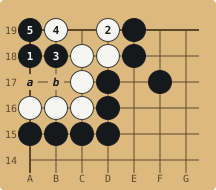

*Part 1a, Diagram 1.* The tree's line to the leaf, with White to play. Black can take the ko by capturing White 4, and a and b are the liberties both sides share.

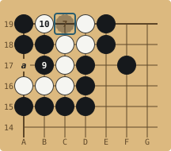

*Part 1a, Diagram 4.* Black invests with Black 9, and White 10 retakes at once without a threat, because Black 9 was not a ko capture. Now White threatens to capture Black's corner stones at a.

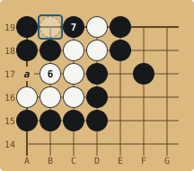

*Part 1a, Diagram 6.* If White invests instead, with White 6, Black 7 takes the ko for free, and Black's capture is a real threat at once.

**Our proposal:** 10kKO for this shape, here and in 10393, 15513, 15516 and c081 (question 2). Is that what you mean by 10kKO?

### Question 1b. A ko that switches there and back: a plain KO?

Problem 7487, leaf 98, Black to kill, marked S[A-1KO-]. Each side needs its own approach, Black at a and White at b. Whoever approaches, the other side retakes for free and still needs its own approach, so the ko switches there and back: by your answer, a plain KO, KO-2 from the count. But White can also use its extra move to capture at c, a second ko whose capture threatens at once; read that way, the whole position is your approach ko, as your A-1KO- says.

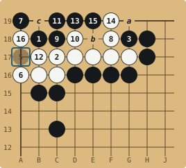

*Part 1b, Diagram 1.* The tree's line to the leaf marked S[A-1KO-]. White 16 has just taken the ko; Black can approach at a, White at b, and c is a second ko.

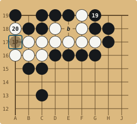

*Part 1b, Diagram 3.* Black approaches with Black 19, and White 20 retakes without a threat, since the ko ban held only for White 18. White's capture still needs its own approach at b.

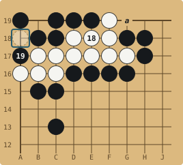

*Part 1b, Diagram 5.* The other way round: Black 17 plays elsewhere, White approaches with White 18, and Black 19 retakes without a threat. Black's capture still needs its own approach at a.

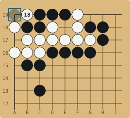

*Part 1b, Diagram 7.* The second ko: Black 17 plays elsewhere and White 18 captures at c. This capture is a real threat at once: if Black passes again, White wins even against four ko threats.

**Options:** KO-2, the plain KO from the count, or your A-1KO-, read through the second ko. No move's grading changes either way.

**Our proposal:** keep your A-1KO- here. The solver prints a plain KO only for a single ko that switches there and back, and marks a switching ko next to a second ko for you instead of choosing. Do you agree?

### Question 2. c081 in 15220: 10kKO or KO+?

Problem 15220, leaf c081, Black to live, marked S[KO+]. The shape of question 1a with the colours reversed: White needs the ko, both sides need the same move at a or b, and whoever plays it hands the other side a direct ko. Problem 15513 marks this very corner S[10kKO].

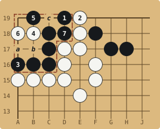

*Part 2, Diagram 1.* The tree's line to the leaf marked S[KO+], with White to play. Black's group and White's corner stones share the liberties a and b, and White can take a ko at c once Black 5 is in atari.

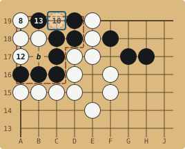

*Part 2, Diagram 4.* Black 11 plays elsewhere again, White 12 invests at a, and Black 13 retakes without a threat, because White 12 did not capture. White's four stones are now in atari at b, so White needs the first ko threat.

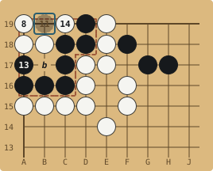

*Part 2, Diagram 7.* If Black also invests, with Black 13 at a after White 12 plays elsewhere, White 14 retakes without a threat. Black's group is now in atari at b, and Black needs one threat more than White.

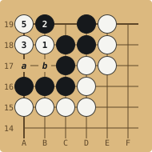

*Part 2, Diagram 13.* The tree's line to its only leaf, marked S[10kKO]: the corner of Diagram 2, with Black to play after White 5. The tree's comment calls it a ten-thousand-year ko in which White still has to approach at b.

**Options:** KO+, the tree's label, which gives the count of a plain ko, or 10kKO. No move's grading changes in 15220 either way.

**Our proposal:** 10kKO, the same as question 1a. Do you agree?

### Question 3. c014 in 2359: KO- or A-1KO+?

Problem 2359, leaf c014, Black to live, marked S[DEAD]. It is a ko in which Black needs one threat more than White. Black takes first, White connects, and Black then needs the extra move at b (E19) before connecting at c; White's only answer to it is the retake.

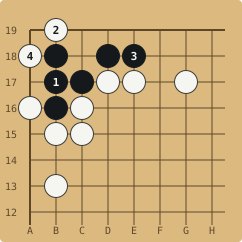

*Part 3, Diagram 1.* The tree's line, marked S[DEAD], with Black to play. It is a ko: Black lives with one threat more than White.

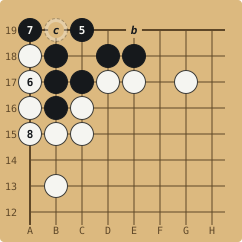

*Part 3, Diagram 3.* White 8 connects, and Black holds the ko with Black to play. Connecting at c does not live yet: Black needs two moves in a row, first b (its best extra move) and then c.

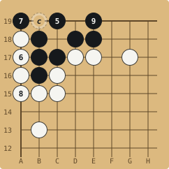

*Part 3, Diagram 4.* Black 9 is the move at E19. White cannot play elsewhere, and its only answer is the retake at c: if White may not play there, Black wins.

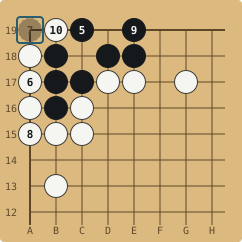

*Part 3, Diagram 5.* White 10 retakes without a threat, since Black 9 was not a ko capture. White's capture threatens to kill at once, so Black needs a threat to retake.

**Options:** KO-, with E19 an extra move inside the ko, or A-1KO+, with E19 an approach. Both need the same threats, and no move's grading changes in 2359.

**Our proposal:** A-1KO+. Only Black needs the extra move, and White can win by winning the ko once, at any time: your approach ko. Which do you want?

### Question 4. 10005: the structure or the count?

Problem 10005, Black to kill, marked S[A-1KO-]. Your label fits the ko when White takes at once: White's capture threatens, and Black's retake needs the approach at b first (Diagram 4). But Black can play the approach at once (Diagram 7). White's best answer is the second ko, and Black ends up needing only one threat more than White (Diagram 10), where A-1KO- implies two.

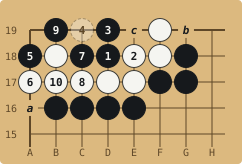

*Part 4, Diagram 1.* The tree's line to the leaf marked S[A-1KO-], with Black to play. White's group has the outside liberties a, b and c, and White can take a ko by capturing Black 5.

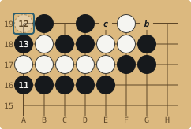

*Part 4, Diagram 4.* Black 13 retakes after a ko threat elsewhere. White's group still has b and c, so Black's capture threatens nothing yet.

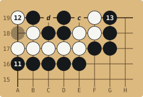

*Part 4, Diagram 7.* Black 13 plays the approach at once, without retaking. Black still needs only one threat more than White, the count at the leaf.

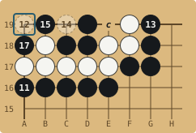

*Part 4, Diagram 10.* White 16 has no threat and plays elsewhere, and Black 17 takes the main ko without a threat, since White 16 captured nothing. White's group is in atari at c.

**Options:** A-1KO-, the structure, or a label from the count (A-1KO+ or KO-). No move's grading changes in 10005.

**Our proposal:** keep your A-1KO-, and the solver prints the count beside it as a note. Do you agree?

### Question 5. A second ko after the capture: 215 and 13169

Problem 215, leaf 5, marked S[A-1KO+], and problem 13169, leaf 3, marked S[A-1KO-] (the same corner with White taking first). White can ignore Black's capture once, and Black needs one more move: your labels count it as an approach, the clean kill. But Black can throw in at A19 instead: White takes four stones, and Black takes a new ko first, which saves Black one threat. The corner then has the shape of a bent four, but it is a ko Black must start at once, not your BENT4 (Diagram 3).

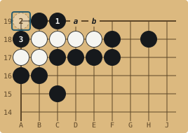

*Part 5, Diagram 1.* The tree's line to leaf 5, marked S[A-1KO+], with White to play. Black 3 has just taken the ko by capturing White 2, and White's group has two outside liberties, a and b.

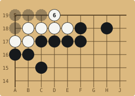

*Part 5, Diagram 2.* If White 4 plays elsewhere, Black 5 throws in at A19, filling its own ko, and White 6 takes four stones. Black has lost nothing: it still needs only as many threats as White.


*Part 5, Diagram 3.* The corner has the shape of a bent four, but Black must start the ko at once: if Black 7 plays elsewhere, White lives.

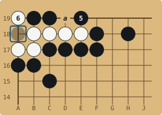

*Part 5, Diagram 5.* The clean kill: White 4 plays elsewhere, Black 5 fills b instead, and White 6 retakes without a threat, since Black 5 captured nothing. White's capture threatens at once, so Black needs a threat to retake: one more than White.

**Options:** count the throw-in, KO+ in 215 and KO- in 13169, or your A-1KO+ and A-1KO-, the clean kill. No move's grading changes in either problem.

**Our proposal:** keep yours, with the solver's count beside them as a note: a ko is direct only when the capture must be answered at once, and here White can play elsewhere once. Do you agree?

### Question 6. SEKI+ and SEKI

besogo prints S[SEKI+] as a seki in sente and S[SEKI] as one in gote. The solver reads SEKI+ as a seki in which the solver keeps sente: at the leaf the solver may play elsewhere, or the opponent must answer first. Your trees have 37 SEKI+ and 185 SEKI leaves; in the trees that use the +, the solver agrees with 30 of the 32 leaves it decides. Problem 2521 has your own split (Diagrams 1 and 2); 1881 leaf 2 is your SEKI+ where Black must still connect (Diagram 3); 1862 leaf 1 is your SEKI where White must answer (Diagram 5).

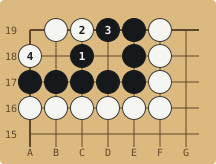

*Part 6, Diagram 1.* Leaf 1, marked S[SEKI+]. White 4 is the last move of the seki, and Black may play elsewhere.

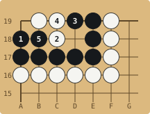

*Part 6, Diagram 2.* Leaf 3, marked S[SEKI]. Black 5 is the last move, and White may play elsewhere: even with a free move, Black cannot live without the seki.

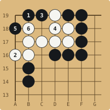

*Part 6, Diagram 3.* Leaf 2, marked S[SEKI+], with Black to play. If Black plays elsewhere, White can fight a ko to live without seki, and Black needs one threat more than White to stop it.

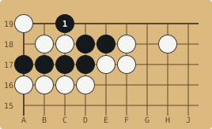

*Part 6, Diagram 5.* Leaf 1, marked S[SEKI], with White to play. If White plays elsewhere, Black lives without seki, so White must answer.

**Options:** SEKI+ when the solver keeps sente (the solver's reading), SEKI+ only when the opponent made the last move, or no + from the solver at all.

**Our proposal:** SEKI+ when the solver keeps sente. Per leaf: keep 2521; S[SEKI] for 1881 leaves 2 and 4; S[ALIVE] for 2089 leaf 2; S[SEKI+] for 1862 leaf 1 if trees that use no + should get it. None of these changes a grade. Is that your meaning?

### Question 7. 15678: kill the whole White group, or only the top stones?

Problem 15678 (research report, under Decisions). Every DEAD leaf of the tree kills only the top stones, while White's left side lives; the solver, given the whole group, says ALIVE. You asked whether to (a) improve the solver's choice of target, or (b) add a stone or two to the problem.

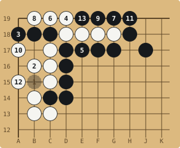

*Research report, Diagram 1.* The tree's main line, leaf c120, marked S[DEAD]. White 12 captures Black 1, and Black 13 leaves the seven top stones one liberty, at A19.

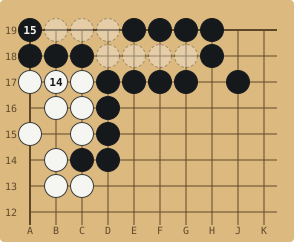

*Research report, Diagram 2.* From Diagram 1: White 14 puts Black's three corner stones in atari, so Black 15 must capture the seven top stones. White's left side lives with two real eyes, at A16 and B15: DEAD for the top stones, ALIVE for the whole group.

**Our proposal:** (a). The solver should not join stones across a cut diagonal, and should take as its target the stones the tree's kill lines kill. With the top stones as the target, c121 comes out S[A-1KO-], your label. Shall we do (a)?

### Question 8. Open board edges: c013 in 2359 and c052 in 11320

These two leaves change label with how much of the empty board counts (research report, under Decisions). The solver treats everything outside its search area as the attacker's wall; the site shows the board open.

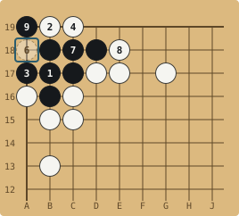

*Research report, Diagram 1.* 2359, Black to live: the tree's line to leaf c013, marked S[KO-], where White 6 takes the ko. On the board as given, Black 7 forces White 8, and Black 9 takes the ko back without a threat. White 2 and White 4 are now in atari, so White needs the first threat: S[KO+].

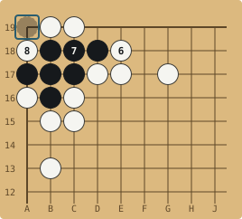

*Research report, Diagram 3.* 2359, the tree change that goes with S[KO+] on leaf c013: White 6 here instead of taking the ko. After Black 7, White 8 takes the ko and Black's group is in atari at D19, so Black needs one threat more than White: a plain KO−, as a judge found.

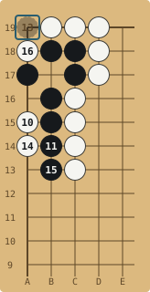

*Research report, Diagram 4.* 11320, Black to live, from the tree's leaf c052, marked S[KO-2]: White has just retaken the ko at A18, and three Black stones are in atari at B17. Black 9 retakes after a threat elsewhere. White 10 forces Black 11, and White 12 retakes without a threat. Black 13 needs another threat, and White 14 and Black 15 repeat the exchange before White 16 retakes. If Black connects the ko instead of answering, White kills.

**Our proposal:** count the board as the player sees it, and where a problem needs a closed edge, put the stones in the SGF. That makes c013 S[KO+], with White's move 6 moved to E18, and c052 either S[KO-4] on the open edge or S[KO-6] with White stones closing the edge at row 10. Do you agree?

### Question 9. Equal counts at the leaf

When the side to move can either take first and then approach, or approach first and let the other side take, and both need the same threats, should the label be the one besogo ranks higher for that side (fewer approaches)? No leaf in your trees shows this yet, so there is no diagram; the solver will flag the first one it finds.

### Question 10. Superko

Your trees have no DSKO or ASKO leaf, so there is no diagram. Is superko positional superko, a whole-board position that may not repeat?

### Answered

- **c121 in 15678:** S[A-1KO-], set on the site on 14 November. What White gains with the free move of an approach round belongs to the approach; the solver prints it beside the label.
- **Approach ko, 10kKO and plain KO:** your definitions are in D9; questions 1a and 1b check how they apply.

---

## Appendix A. How the three proposals were judged

| | Design 1: threshold line | Design 2: ko structure | Design 3: tempo profiles |
|---|---|---|---|
| Approach count | from events on one line at the leaf's count | static: fewest X stones that make X's capture direct, by enumeration | by search: Y forced to pass k times, X's moves found by the engine |
| Needs the leaf's full count | yes. c121 needed T=3 and three moves given by hand | no | no |
| Owner's rule (c121) | "absorbed" threat by a geometric rule plus a dependence check | δ = T - (n + f + e), reported | built into the definition (forced tenuki in approach rounds); gain measured |
| Preparation before the first take | from the line | the ko position must keep T. 10005 counted A16 as an approach (n=2, owner 1) | from the line (10005: n=1, owner's A-1KO-) |
| Threat attribution | needed or answered tests, geometric | the winner's PV | barring while banned (verified on c005) |
| Double ko | counted table [-3..+3] (unreliable: c027 fails at o=6 with the fixed end rule) | counted extremes, o=8 (end-rule dependent) | cycle rules in the modes (verified on c027) |
| End-of-game fix | static seki-standoff rule in all modes | play on at double pass when a ko capture or atari remains, all modes | play on while a defender chain is in atari, MODE_N only |
| Explanation | best: numbered line with roles | parts and counted summary | record, one sentence, PVs |
| Cost | 8-58 searches, ≤4 s per leaf | enumeration up to 73 s, one leaf minutes | about 1 s per enclosed label |
| Checked against owner labels | no | 20/32 exact plus 3 mutual | 10005 (where Design 2 failed) |

**Design 3 wins on correctness:**
- every one of its label claims that I re-ran held: c121, c023, c011, c010, c073, c019, c014, c081, c027, 10005;
- the owner's rule is part of its definitions, not a patch;
- it is the only design whose label survives the open positions where the full count is undecided.

**Its weaknesses are fixed above:**
- the end trigger (0.1-2);
- the inferred class (0.1-3);
- the per-round gain (0.1-4);
- negative gains;
- the first-take fallback and the tie rule;
- mutual approaches.

**What the other two contribute:**
- Design 1: the explanation layer and the tooling (BENT4 fix, `solvemoves`, escalation, warnings, comparison
  order).
- Design 2: the end-trigger clause, PV, `cycles=`, `sekikill`, the record and the owner-label batch.

## Appendix B. Verification runs (engine_x, one search at a time)

Scripts and logs are in `/tmp/claude-0/proto/research/kodesign/judge/`:

| script | what it checks | log |
|---|---|---|
| `j121.py` | c121 model: profile, held-ko, n_O, direct ko, H19 gain | `j121.out` |
| `j121m.py` | c121 model modes: A=N, D=U at 2M and 4M | output in this conversation only |
| `j121f.py` | held-ko check without a forced pass: undecided at 4M | output in this conversation only |
| `jprof.py` | generic forced-pass profile | `c005.out`, `c010.out`, `c011.out`, `c014.out`, `c019.out`, `c023.out`, `c073.out`, `10005.out` |
| `j081.py` | c081 corner region, `end=0` and `end=1`, both profiles | `j081.out` |
| `j027.py` | c027 cycle rules, bent-four test, counted o=3/4/6 with `end=0` and `end=1` | `j027.out` |
| `jsolve.py` | 10391 modes and counts | output in this conversation only |

Design 2's engine on c027 (`structure/ks.py … count 0 o --endplay`): Black wins at o = 4, 6 and 8.

The judge used about 2 minutes of engine time in total. The longest single search took 18 s.

---

## Addendum (15 November): what the question page found

Items 1 to 3 below are now in D9, section 11 and section 13.

The page `research/questions/` (question 1's inventory is in `research/questions/inventory/`) checked the design's
claims about mutual approach and three single leaves against the owner's own labels and definitions. Changes the
implementation needs, pending the owner's answers:

1. **D9 needs the switch test.** "Each side needs one approach" covers two different shapes. When both sides need the
   same move (a liberty both groups share), one investment makes the other side's free retake a real threat at once:
   that is the owner's 10kKO (10391, 10393, 15513, 15516, c081). When the approaches are at different points and the
   free retake still needs its own approach, the ko switches there and back: the owner's plain KO, from the count.
   Printing 10kKO for every mutual 1/1 (D9 as written) is wrong for the second shape (7487 leaf 98). A second ko that
   gives one side a direct threat makes the reading ambiguous (7487): mark such leaves for the owner.
2. **10408 is not mutual** (White's capture threatens at once), and **10403's and 9883's A+1 labels are not graded
   like 10kKO** (in a KILL problem 10kKO ranks like A-1). Section 11 risk 4 and open question 2 are wrong on both.
3. **Section 13 question 3 is wrong about grading:** c081's label changes no move's grade in 15220.
4. **c014:** read by the owner's approach-ko definition, the label is A-1KO+ (only Black needs E19, and White can
   win the ko once at any time), not KO-. If he agrees, replace the D7 stage fallback: when X's capture is a threat
   that Y answers locally without retaking, count X's approaches from the position after Y's answer, confirmed by
   D4, and pick the approach that keeps the best count (E19, not F19 or F18).
5. **10005:** E19 is the capture, not an approach (D3's alternatives admitted moves that fail once the opponent may
   answer; fixed: D3 now keeps an alternative only when it keeps v with the opponent free to answer it); the approach is
   A16, after the preparation G19, as the checker prints it (the two can swap roles: section 10). White can also wait
   before taking, with the same count, and D2's canonical loser order may then build the principal line with White
   passing, which gives A+1KO-2 instead of A-1KO-. The first take needs a rule for this.
6. **Semeai shapes:** D3 counts 3 or 4 approaches where the count is one threat (13541 leaves 1 and 6, 11280 leaves 9
   and 18, 13475 leaf 8). Approaches there come with tempo (section 11 risk 2 is real), so the approach count needs a
   bound from the count before it is printed.
7. **2406:** in the corner frame A16:F19 the prototype engine gives d = -1 (White 2, Black 0), not the d = 0 and
   mutual 1/1 of section 10.
8. **The tree is not consistent:** identical profiles and counts carry 10kKO and A-1KO+ (13547 leaves 1 and 2;
   15516 against 13549 leaf 10), so no rule reproduces every tree label; the checker reports such leaves as notation
   or for the owner, never silently.
9. **The sekikill fix outside question 6's table.** Counting every repetition as a kill under `sekikill` (section 2)
   also turns S[ALIVE] leaves into seki. A census of the owner's 1,537 S[ALIVE] leaves and 2,015 other leaves outside
   the table (Solver.status as the question page builds it, on the code of the fix with the engine before and after
   it, 200,000 nodes, the candidates left open again at 2,000,000) finds 8 decided classes that change, all of them
   S[ALIVE], and none changes a grade (besogo's own code): 2387 leaf 4 becomes SEKI+, and 844 leaves 3 and 6, 5628
   leaf 7, 7487 leaf 80, 7546 leaf 8, 10971 leaf 11 and 11279 leaf 21 become SEKI. In each, the seki test's solve
   before the fix let the target live only through repetitions it scored as life (2 to 115 adjudicated cycles), and
   that scoring is the only difference between the engines; after the fix the attacker's line ends in a repetition
   (844 leaf 3, 7487 leaf 80, 7546 leaf 8, 10971 leaf 11), at an end where the target stands without unconditional
   life (11279 leaf 21), or, since a proof's line keeps only the winner's moves, in a capture. They are new
   `status-mismatch` findings against S[ALIVE], listed in question 6. No other leaf can change: no other seki test ran
   without saying alive. The census cannot see the 310 S[ALIVE] leaves whose class is undecided before the seki test
   at 200,000 nodes (not retried) or the 16 whose seki test stays undecided at 2,000,000 nodes on both engines.
